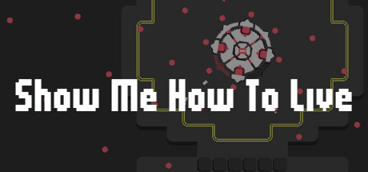

**LIVE A LIVE is Square's 1994 JRPG anthology featuring eight standalone chapters across different time periods including Prehistory, Feudal Japan, and the Far Future. The HD-2D remake preserves the original's unique chapter structure and adds beautiful visuals.**

---

## 📖 About

LIVE A LIVE is Square's 1994 JRPG anthology featuring eight standalone chapters across different time periods including Prehistory, Feudal Japan, and the Far Future. The HD-2D remake preserves the original's unique chapter structure and adds beautiful visuals.

## ⚠️ Problems Without Trainer

| Problem | Status |
|---------|--------|
| **Cube Chapter Navigation** — Science fiction chapter requires very careful routing to avoid death | ✅ Solved |
| **Final Chapter Difficulty** — Oersted's chapter and the true final boss are significantly harder | ✅ Solved |
| **Chapter Isolation** — Each chapter must be approached as a separate game with unique mechanics | ✅ Solved |
| **Wrestle Chapter Perfection** — Getting all wins in the Pro Wrestling chapter requires memorizing combo inputs | ✅ Solved |

## ✅ Solution

The **LIVE A LIVE Trainer** solves all these issues by giving you complete control over the game.

## 🎯 Full Feature List

- Unlimited Resources
- God Mode / Invincibility
- Instant Skill Cooldown
- One-Hit Kill
- Freeze Game Timer
- Unlock All Items & Achievements
- Custom Speed Multiplier
- Save State Anywhere

## 🚀 Quick Start

1. **Disable Windows Defender** temporarily (trainer may trigger false positive)
2. Download the trainer from the button above
3. Launch LIVE A LIVE
4. Run the trainer as Administrator
5. Activate desired cheats with hotkeys

## 💎 Free vs Paid

| Feature | Free | Pro |
|---------|------|-----|
| Basic God Mode | ✅ | ✅ |
| Unlimited Resources | ✅ | ✅ |
| All Advanced Cheats | ❌ | ✅ |
| Auto-Updates | ❌ | ✅ |
| Priority Support | ❌ | ✅ |

## 💻 Requirements

- Windows 10/11 (64-bit)
- LIVE A LIVE (any version)
- .NET Framework 4.8+
- DirectX 11+

## 🍎 macOS

macOS users can use our alternative tool:

## ⚖️ Legal

This trainer is for educational and single-player use only. Use responsibly.

---

